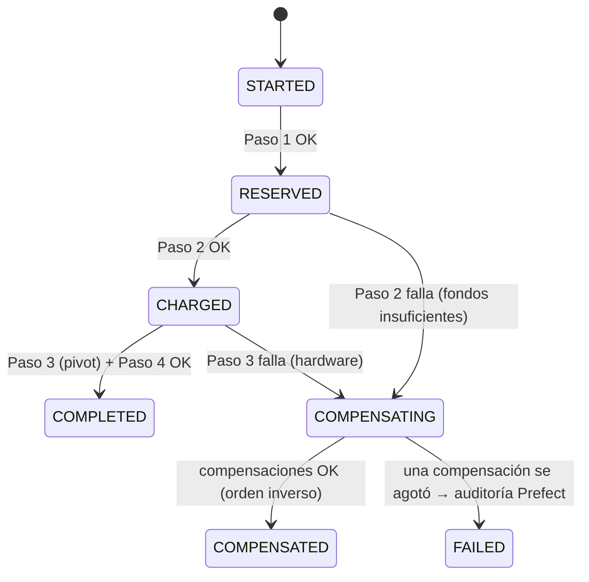

# Capa 3 — Backend, Microservicios, GraphQL, SAGA y Feature Flags (25%)

## Mapa rápido

| Qué | Dónde |
|-----|-------|
| Esquema GraphQL unificado | [graphql-gateway/src/schema.graphql](../../graphql-gateway/src/schema.graphql) |
| Resolvers (agregación) | [graphql-gateway/src/resolvers.ts](../../graphql-gateway/src/resolvers.ts) |
| **Motor SAGA (orquestación)** | [graphql-gateway/src/saga/engine.ts](../../graphql-gateway/src/saga/engine.ts) |
| **Definición de la SAGA y sus compensaciones** | [graphql-gateway/src/saga/reserve-charge-saga.ts](../../graphql-gateway/src/saga/reserve-charge-saga.ts) |
| Log de la SAGA en DynamoDB | [graphql-gateway/src/saga/store.ts](../../graphql-gateway/src/saga/store.ts) |
| Paso 1 + compensación (bahías) | [services/station-reservation-service/src/repository.ts](../../services/station-reservation-service/src/repository.ts) |
| Paso 2 + compensación (billetera) | [services/billing-wallet-service/src/repository.ts](../../services/billing-wallet-service/src/repository.ts) |
| Surge pricing | [services/billing-wallet-service/src/pricing.ts](../../services/billing-wallet-service/src/pricing.ts) |
| Paso 3 + inyección de fallo | [services/energy-dispatch-service/src/app.ts](../../services/energy-dispatch-service/src/app.ts) |
| Cliente de feature flags | [packages/common/src/flags.ts](../../packages/common/src/flags.ts) |
| Logger JSON con `correlation_id` | [packages/common/src/logger.ts](../../packages/common/src/logger.ts) |
| Imagen Docker genérica | [docker/node-service.Dockerfile](../../docker/node-service.Dockerfile) |
| Pruebas unitarias de la SAGA | [graphql-gateway/test/saga-engine.unit.test.ts](../../graphql-gateway/test/saga-engine.unit.test.ts) |
| Prueba E2E del rollback | [tests/e2e/reserve-charge.e2e.test.ts](../../tests/e2e/reserve-charge.e2e.test.ts) |

## Arquitectura

```
                        Cliente / Frontend
                               │  POST /graphql
                               ▼
                 API Gateway ─► VPC Link ─► NLB ─► graphql-gateway  (capa de agregación + ORQUESTADOR SAGA)
                                                       │  HTTP + x-correlation-id = sagaId
                    ┌──────────────────────────────────┼──────────────────────────────────┐
                    ▼                                  ▼                                  ▼
     station-reservation-service         billing-wallet-service             energy-dispatch-service
     bloqueo temporal de bahías          fondos, cobro, reembolso           activación física + telemetría
                    │                                  │                                  │
     aegisvolt-reservations-<env>        aegisvolt-billing-<env>            aegisvolt-dispatch-<env>
                    └───────────── aegisvolt-feature-flags-<env> (lectura) ──────────────┘
                     graphql-gateway ─► aegisvolt-saga-<env> (log de la SAGA)
```

- **Desacople.** Cada servicio es un contenedor independiente con su propia tabla (Database-per-Service), su propio rol IAM (Pod Identity) y su propia API HTTP. El gateway **nunca** lee tablas de otros servicios: solo los llama por HTTP.
- **Una sola imagen por servicio para los 3 ambientes.** Lo que cambia entre ambientes es el ConfigMap: `AEGIS_ENV`, las URLs, `FLAG_ADMIN_ENABLED`, etc.

## La SAGA "Reservar y Activar Carga"

| # | Paso | Servicio | Tipo | Compensación |
|---|------|----------|------|--------------|
| 0 | `PRICE_QUOTE` | billing | compensable (lectura) | — |
| 1 | `RESERVE_CONNECTOR` | station | compensable | `POST /reservations/:sagaId/release` → `AVAILABLE` |
| 2 | `CHARGE_WALLET` | billing | compensable | `POST /charges/:sagaId/refund` → reembolso y evento `REFUND` |
| 3 | `ACTIVATE_CHARGER` | dispatch | **pivot** | — (si falla, se compensan 2 y luego 1) |
| 4 | `CONFIRM_RESERVATION` | station | retriable | — (se reintenta, no se compensa) |



**¿Por qué orquestación y no coreografía?**
- El flujo tiene un orden estricto y compensaciones en orden inverso. Un orquestador lo hace **explícito y auditable**: el log de la SAGA en `aegisvolt-saga-<env>` muestra cada paso, intento y compensación.
- Con coreografía la lógica queda dispersa en eventos y es difícil saber en qué estado está una transacción.
- Costo aceptado: el orquestador es un punto central. Se mitiga porque es *stateless*: el estado vive en DynamoDB y el proceso se puede reemplazar.

**¿Por qué no una transacción ACID / 2PC?** Cada servicio tiene su propia base de datos, y DynamoDB no participa en transacciones distribuidas XA/2PC. Además, 2PC bloquea recursos mientras espera a todos los participantes. La SAGA cambia atomicidad global por **consistencia eventual** con compensaciones semánticas: el reembolso no "borra" el cobro, **registra un evento de reversión**.

---

## Pregunta guía 1

### Active la Feature Flag de fallo en el ambiente `test`, dispare una mutación GraphQL de reserva de carga y demuestre en las tablas de DynamoDB cómo se ejecutó la transacción compensatoria en el servicio de facturación y reservas.

**Respuesta corta:** activo `SIMULATE_CHARGER_HARDWARE_FAULT` en `aegisvolt-feature-flags-test` (por la UI, por GraphQL o con la CLI) y ejecuto `reserveAndActivateCharge`. El paso 3 falla con `CHARGER_HARDWARE_FAULT` y el orquestador compensa en orden inverso:
1. Billing **reembolsa**: aparece un item `TXN#<sagaId>#REFUND` y el saldo vuelve al valor original.
2. Station **libera la bahía**: la reserva queda `RELEASED` y el conector `AVAILABLE`.

La mutación devuelve `status: COMPENSATED` con el detalle de cada compensación.

**Paso a paso:**
```powershell
$env:AWS_ENDPOINT_URL="http://localhost:4566"
$API = "<url del API Gateway de test>"   # terraform output api_endpoint (workspace test)

# 1. Activar la flag de fallo SOLO en test (sin redesplegar)
aws dynamodb update-item --table-name aegisvolt-feature-flags-test `
  --key '{\"flag\":{\"S\":\"SIMULATE_CHARGER_HARDWARE_FAULT\"}}' `
  --update-expression "SET enabled = :t, updatedBy = :u" `
  --expression-attribute-values '{\":t\":{\"BOOL\":true},\":u\":{\"S\":\"demo-cli\"}}'
#    (alternativa: mutation { setFeatureFlag(name:"SIMULATE_CHARGER_HARDWARE_FAULT", enabled:true) { enabled } })

# 2. Saldo ANTES
aws dynamodb get-item --table-name aegisvolt-billing-test `
  --key '{\"pk\":{\"S\":\"WALLET#fleet-andina\"},\"sk\":{\"S\":\"META\"}}' --query Item.balanceCents

# 3. Disparar la SAGA
$q = '{"query":"mutation { reserveAndActivateCharge(input:{fleetId:\"fleet-andina\", stationId:\"st-bog-norte\", kwh:20}) { sagaId status error { step code } compensations { step outcome } } }"}'
Invoke-RestMethod -Method Post -Uri "$API/graphql" -ContentType application/json -Body $q | ConvertTo-Json -Depth 6
#  => status: COMPENSATED, error.step: ACTIVATE_CHARGER, code: CHARGER_HARDWARE_FAULT
#  => compensations: [ CHARGE_WALLET: REFUNDED, RESERVE_CONNECTOR: RELEASED ]
$SAGA = "<sagaId devuelto>"

# 4. FACTURACION: cobro + reembolso (evento de reversion) y saldo restaurado
aws dynamodb query --table-name aegisvolt-billing-test `
  --key-condition-expression "pk = :p AND begins_with(sk, :t)" `
  --expression-attribute-values "{\":p\":{\"S\":\"WALLET#fleet-andina\"},\":t\":{\"S\":\"TXN#$SAGA\"}}" `
  --query "Items[].{sk:sk.S,tipo:type.S,monto:amountCents.N,desc:description.S}" --output table

# 5. RESERVAS: la reserva quedo RELEASED y el conector AVAILABLE
aws dynamodb get-item --table-name aegisvolt-reservations-test `
  --key "{\"pk\":{\"S\":\"RESERVATION#$SAGA\"},\"sk\":{\"S\":\"META\"}}" `
  --query "Item.{estado:status.S,motivo:releaseReason.S,conector:connectorId.S}"
aws dynamodb query --table-name aegisvolt-reservations-test `
  --key-condition-expression "pk = :p" --expression-attribute-values '{\":p\":{\"S\":\"STATION#st-bog-norte\"}}' `
  --query "Items[?begins_with(sk.S,'CONNECTOR')].{conector:connectorId.S,estado:status.S,reservadoPor:reservedBy.S}" --output table

# 6. DESPACHO: sesion FAILED con el codigo de falla
aws dynamodb get-item --table-name aegisvolt-dispatch-test `
  --key "{\"pk\":{\"S\":\"SESSION#$SAGA\"},\"sk\":{\"S\":\"META\"}}" --query "Item.{estado:status.S,falla:faultCode.S}"

# 7. LOG DE LA SAGA: pasos y compensaciones en orden
aws dynamodb get-item --table-name aegisvolt-saga-test `
  --key "{\"pk\":{\"S\":\"SAGA#$SAGA\"},\"sk\":{\"S\":\"META\"}}" --query "Item.{estado:status.S,compensaciones:compensations}"

# 8. Apagar la flag
aws dynamodb update-item --table-name aegisvolt-feature-flags-test `
  --key '{\"flag\":{\"S\":\"SIMULATE_CHARGER_HARDWARE_FAULT\"}}' `
  --update-expression "SET enabled = :f" --expression-attribute-values '{\":f\":{\"BOOL\":false}}'
```

**Qué mostrar en cada tabla:**

| Tabla | Antes | Después del rollback |
|-------|-------|---------------------|
| `aegisvolt-billing-test` | `balanceCents = X` | `TXN#<saga>#CHARGE` (−monto) + `TXN#<saga>#REFUND` (+monto) → `balanceCents = X` |
| `aegisvolt-reservations-test` | conector `AVAILABLE` | `RESERVATION#<saga>` = `RELEASED`; conector `AVAILABLE` sin `reservedBy` |
| `aegisvolt-dispatch-test` | — | `SESSION#<saga>` = `FAILED`, `faultCode = CHARGER_HARDWARE_FAULT` |
| `aegisvolt-saga-test` | — | `status = COMPENSATED`, compensaciones `[CHARGE_WALLET: REFUNDED, RESERVE_CONNECTOR: RELEASED]` |

**Por qué el orden es billing primero y luego station:** las compensaciones se ejecutan en **orden inverso** a los pasos (pila LIFO). El último paso que tuvo éxito se deshace primero. Así nunca queda una bahía liberada con el cobro todavía retenido. Esto lo prueban `saga-engine.unit.test.ts` ("orden inverso") y el E2E `SIMULATE_CHARGER_HARDWARE_FAULT`.

**Variante "Paso 2 falla":** con `fleet-caribe`, que tiene 5 USD de saldo, y `kwh: 100`, billing responde `402 INSUFFICIENT_FUNDS` y solo se compensa station (`RELEASED`). No aparece ningún `REFUND`, porque no hubo cobro.

---

## Pregunta guía 2

### ¿Cómo evita su implementación de SAGA problemas de falta de idempotencia si un mensaje o petición de compensación se procesa dos veces?

**Respuesta corta:** cada operación de la SAGA usa el `sagaId` como **clave de idempotencia** con **escrituras condicionales de DynamoDB**. Procesar dos veces la misma petición produce el mismo resultado sin duplicar efectos: no hay doble reembolso, doble cobro ni doble liberación. El servicio responde `ALREADY_REFUNDED` o `ALREADY_RELEASED` en vez de repetir la acción.

**Mecanismos, capa por capa:**

| Nivel | Mecanismo | Código |
|-------|-----------|--------|
| SAGA completa | `idempotencyKey` → `sagaId` determinista. `create()` usa `attribute_not_exists(pk)`: la misma clave **no crea otra SAGA** y devuelve la existente | `store.ts` → `create()`, `engine.ts` → `run()` |
| Cobro (paso 2) | `TransactWriteItems`: `Put TXN#<sagaId>#CHARGE` con `attribute_not_exists` **+** descuento condicionado a `balanceCents >= monto`, todo atómico. Un segundo cobro con el mismo `sagaId` falla en la condición y se devuelve el original (`replayed: true`) | `billing/repository.ts` → `charge()` |
| Reembolso (compensación) | `Put TXN#<sagaId>#REFUND` con `attribute_not_exists` **en la misma transacción** que el `+monto`. Si llega duplicado, la condición falla y **no se suma saldo**: se responde `ALREADY_REFUNDED`. Si nunca hubo cobro: `NOTHING_TO_REFUND` | `billing/repository.ts` → `refund()` |
| Reserva (paso 1) | `Put RESERVATION#<sagaId>` con `attribute_not_exists` + bloqueo del conector condicionado a `status = AVAILABLE` (o lock vencido) | `station/repository.ts` → `reserve()` |
| Liberación (compensación) | La reserva pasa a `RELEASED` solo si estaba `HELD`/`CONFIRMED`. El conector se libera **solo si `reservedBy = sagaId`**: una compensación tardía nunca libera una bahía que ya tomó otra SAGA | `station/repository.ts` → `release()` |
| Activación (paso 3) | `Put SESSION#<sagaId>` con `attribute_not_exists`. Un reintento recibe el **mismo** resultado, incluso la misma falla | `dispatch/repository.ts` → `createSession()` |
| Log de la SAGA | Concurrencia optimista (`version`): dos procesos no pueden pisar el registro | `store.ts` → `save()` |

**Por qué la condición va dentro de la transacción y no en un `if` previo:** el `getTransaction()` previo es solo una optimización. La garantía real es la `ConditionExpression` dentro del `TransactWriteItems`: si dos reembolsos llegan **al mismo tiempo**, ambos pasan el `if`, pero DynamoDB solo deja ganar a uno y el otro recibe `TransactionCanceledException` (`ConditionalCheckFailed`). Esto lo prueba `wallet.int.test.ts` ("reembolsa una sola vez aunque llegue duplicada"), con dos reembolsos en paralelo y el saldo exacto al final.

**Reintentos seguros:** como todo es idempotente, el orquestador **reintenta las compensaciones** con backoff exponencial (`SAGA_COMPENSATION_ATTEMPTS`) y el cliente HTTP reintenta errores 5xx o de red. Los errores de negocio (4xx: fondos insuficientes, falla de hardware) **no** se reintentan.

**Demostración rápida:**
```powershell
# Reembolso duplicado de una SAGA ya compensada: el saldo NO cambia
kubectl -n aegisvolt exec deploy/graphql-gateway -- node -e "
  fetch('http://billing-wallet-service:8080/charges/$SAGA/refund',{method:'POST',headers:{'content-type':'application/json'},
  body:JSON.stringify({fleetId:'fleet-andina'})}).then(r=>r.json()).then(console.log)"
#  => { outcome: 'ALREADY_REFUNDED', alreadyRefunded: true }
```

---

## Otras preguntas probables

**¿Qué pasa si el orquestador muere a mitad de la SAGA?**
1. Cada transición se persiste **antes** de continuar, así que el log dice qué pasos quedaron hechos.
2. La auditoría de Prefect detecta SAGAs no terminales viejas (huérfanas) y llama `recoverTransaction(sagaId)`, que ejecuta las compensaciones pendientes. Esto lo prueba `recover() compensa una SAGA huerfana`.
3. Además, el bloqueo de la bahía tiene **TTL** (`lockExpiresAt`): aunque nadie compense, la bahía no queda bloqueada para siempre.

**¿Qué es el paso pivot?**
- Es el **punto de no retorno**: activar el flujo eléctrico.
- Si falla, se compensa todo lo anterior. Si tiene éxito, la SAGA ya no se revierte.
- Los pasos posteriores (confirmar la reserva) son *retriable*: se reintentan hasta completar y no se compensan.

**¿Qué pasa si una compensación falla definitivamente?** Se reintenta con backoff. Si se agota, el paso queda `COMPENSATION_FAILED` y la SAGA `FAILED`, y se emite `event=saga_failed` con `level=ERROR`. La métrica `SagaFailed` dispara la alarma `aegisvolt-<env>-saga-failed`, y Prefect la reporta para resolverla con `recoverTransaction`.

**¿Cómo se diseñó el esquema GraphQL?**
- Hay un único endpoint que **agrega** los 3 servicios. Las Queries son de lectura (estaciones, telemetría, flags, billeteras, historial de SAGAs). Las Mutations son comandos (iniciar la SAGA, cambiar una flag, recuperar una SAGA, recargar saldo).
- Los fallos de negocio **no** son errores GraphQL. `reserveAndActivateCharge` siempre devuelve un `ChargeTransaction` con `status` (`COMPLETED`, `COMPENSATED` o `FAILED`), `error`, `steps` y `compensations`, así el frontend muestra el rollback.
- Los errores de entrada sí son errores GraphQL (`BAD_USER_INPUT`).
- Campos derivados como `availableConnectors` se calculan en el gateway.
- El CI valida el esquema con `npm run graphql:validate`: cada campo de Query y Mutation tiene resolver y las operaciones del frontend son válidas.

**¿Cómo funcionan las feature flags por ambiente?**
- Hay una tabla por ambiente (`aegisvolt-feature-flags-<env>`). Cada pod lee la de su ambiente (`AEGIS_ENV`) con cache de 3 s.
- Un cambio se ve en todos los pods en ≤ 3 s **sin redesplegar**.
- Terraform siembra los valores iniciales con `ignore_changes`, así un `apply` no revierte un toggle.
- En prod, `FLAG_ADMIN_ENABLED=false` deshabilita la mutación `setFeatureFlag`.

| Flag | Dónde actúa | dev | test | prod |
|------|-------------|-----|------|------|
| `ENABLE_DYNAMIC_SURGE_PRICING` | billing `/quotes`: ×1.5 en hora pico (America/Bogota 7-10 y 17-21) | on | on | off |
| `ENABLE_FAST_CHARGE_BOOST` | station: `priority=true` reserva conector ULTRA (350 kW) y lock más largo | on | on | off |
| `SIMULATE_CHARGER_HARDWARE_FAULT` | dispatch: el cargador "reporta" error físico → rollback | off | off | off |

**¿Cómo se rastrea una SAGA en los logs?** El `sagaId` **es** el `correlation_id`. El gateway lo envía en el header `x-correlation-id` a cada servicio, y el servidor HTTP común lo pone en todos los logs JSON. En CloudWatch Logs Insights:
```
fields @timestamp, service, event, message | filter correlation_id = "saga-..." | sort @timestamp asc
```

**¿Por qué TypeScript, Fastify y graphql-yoga?**
- TypeScript, porque los tipos compartidos entre servicios (`@aegisvolt/common`) y el build real (`tsc`) le dan contenido al job `lint-build`.
- Fastify, por la validación de entrada con JSON Schema y por su rendimiento.
- graphql-yoga, porque es un servidor GraphQL que cumple la especificación y se integra en Fastify, así el gateway comparte con los demás servicios el logging, los health checks y el `correlation_id`.

**Pruebas que respaldan todo esto:**

| Suite | Qué prueba | Total |
|-------|-----------|-------|
| unit | Motor SAGA (orden inverso, reintentos, idempotencia, recover, pivot), SAGA concreta con dobles, pricing, dominio de estaciones, flags y cliente HTTP | 28 |
| integration | Cada repositorio contra DynamoDB real (Floci): concurrencia, idempotencia, locks vencidos, flags y endpoints GraphQL | 25 |
| e2e | 4 procesos + GraphQL: flujo feliz, fallo de hardware con rollback, fondos insuficientes, flag de boost, historial y `correlation_id` en los 4 servicios | 7 |
